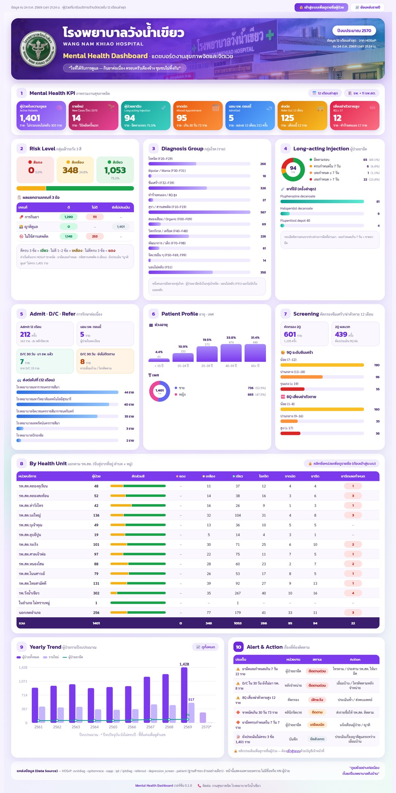
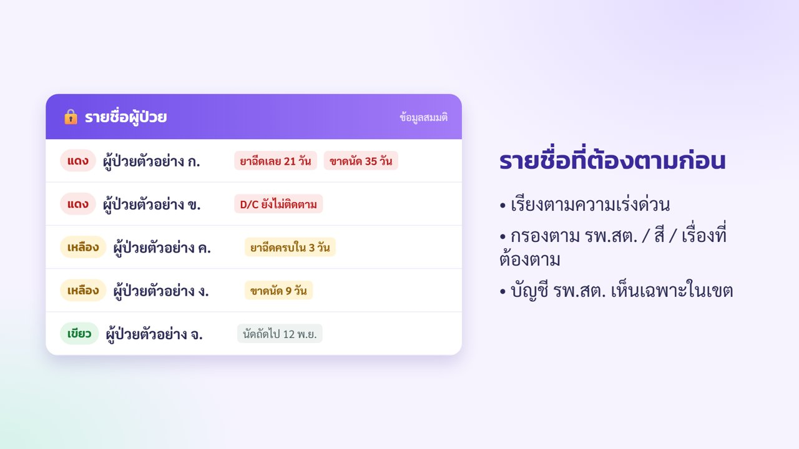
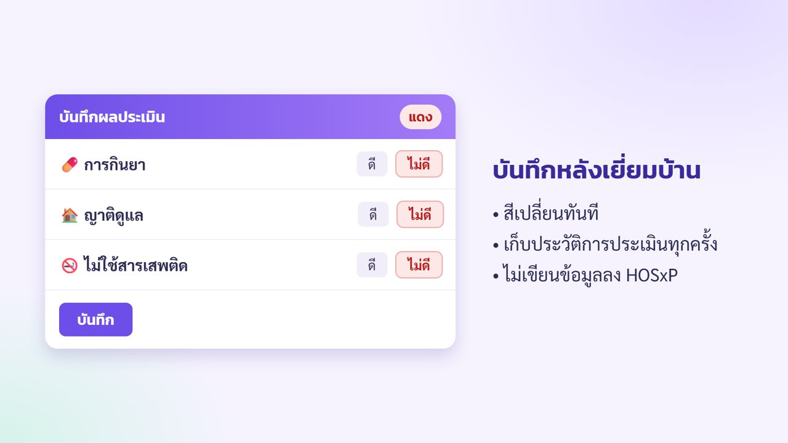

# Mental Health Dashboard — แดชบอร์ดงานสุขภาพจิต (HOSxP)

> **เวอร์ชัน 0.2.0** — ใช้ได้ทุกโรงพยาบาลที่ใช้ HOSxP ·
> **คู่มือติดตั้ง: [INSTALL.md](INSTALL.md) · PDF [docs/MH_Dashboard_install_manual.pdf](docs/MH_Dashboard_install_manual.pdf)** ·
> ดาวน์โหลดชุดติดตั้ง: [Releases](https://github.com/nopneo/mental-health-dashboard-wnk/releases/latest) ·
> ความปลอดภัย: [SECURITY.md](SECURITY.md) · การเปลี่ยนแปลง: [CHANGELOG.md](CHANGELOG.md)

แดชบอร์ดติดตามผู้ป่วยจิตเวชของโรงพยาบาลและ รพ.สต. ในเครือข่าย ดึงข้อมูลสดจาก HOSxP (MariaDB `hos`)
แบบอ่านอย่างเดียว ใช้งานจริงที่โรงพยาบาลวังน้ำเขียว — https://wnkhos.go.th/mh/

| ส่วน | ใครเข้าได้ | แสดงอะไร |
|---|---|---|
| ภาพรวม `/` · ย้อนหลังรายปี `/yearly` | ทุกคน | ยอดรวมเท่านั้น ไม่มีชื่อ / HN |
| รายชื่อ `/patients` · รายละเอียด `/patient/<hn>` | เจ้าหน้าที่ที่มีบัญชี | รายชื่อที่ต้องติดตาม + ฟอร์มประเมิน 3 ข้อ |



## ทำอะไรได้บ้าง

- **ภาพรวม 10 บล็อก** — ผู้ป่วยในความดูแล, รายใหม่, ขาดนัด, ยาฉีด LAI (ตามรอบ/เลยกำหนด), นอน รพ., D/C ที่ยังไม่ติดตาม,
  ส่งต่อ, 8Q เสี่ยงสูง, กลุ่มโรค, อายุ/เพศ, ผลคัดกรอง 2Q/9Q/8Q, ตารางแยกตาม รพ.สต., แนวโน้มรายปี, Alert & Action
- **กลุ่มเฝ้าระวัง 3 สี** — ประเมิน การกินยา · ญาติดูแล · ไม่ใช้สารเสพติด: ดีครบ = เขียว, ไม่ดี 1–2 ข้อ = เหลือง,
  ไม่ดีครบ = แดง · ค่าเริ่มต้นจาก HOSxP (ขาดนัด, ยาฉีดเลยกำหนด, รหัส F10–F19) ปรับด้วยผลประเมินในแอป
- **รายชื่อที่ต้องตามก่อน** — เรียงตามความเร่งด่วน กรองตาม รพ.สต. / สี / เรื่อง / กลุ่มโรค · บัญชี รพ.สต. เห็นเฉพาะในเขต
- **บันทึกผลประเมิน** หลังเยี่ยมบ้าน — เก็บเป็นประวัติใน SQLite ของแอป ไม่เขียนลง HOSxP
- **ย้อนหลังรายปีงบประมาณ** 12 ตัวชี้วัด ตั้งแต่ปีงบ 2561

| รายชื่อผู้ป่วย (ภาพจำลอง) | บันทึกผลประเมิน (ภาพจำลอง) |
|---|---|
|  |  |

## เริ่มเร็ว

```bash
python3 -m venv .venv && .venv/bin/pip install -r requirements.txt
cp .env.example .env            # แก้ DB_* (บัญชีอ่านอย่างเดียว) และค่า MH_* ของโรงพยาบาล
cp village_pcu.example.csv village_pcu.csv   # ใส่หมู่บ้าน → รพ.สต. ของอำเภอ
.venv/bin/python manage.py adduser mhadmin --display "งานสุขภาพจิต" --admin
.venv/bin/gunicorn -b 127.0.0.1:6300 app:app      # หรือ python app.py ตอนทดสอบ
```

ติดตั้งจริง (ผู้ใช้ไม่ใช่ root, systemd, Apache/Nginx sub-path `/mh/`) ดู [INSTALL.md](INSTALL.md)

## ไฟล์

| ไฟล์ | ใช้ทำอะไร |
|---|---|
| `app.py` | Flask: หน้าเว็บ, login, สิทธิ์ตามหน่วยบริการ |
| `queries.py` | SQL ทุกตัว + คิดสี / ขาดนัด / รอบยาฉีด / สรุปตัวเลข |
| `store.py` | SQLite ของแอป (บัญชีผู้ใช้, ผลประเมิน) |
| `db.py` | ต่อ HOSxP (charset tis620, session read-only) |
| `manage.py` | จัดการบัญชีผู้ใช้ |
| `.env.example` · `village_pcu.example.csv` | ตัวอย่างค่าตั้งของโรงพยาบาล |
| `deploy/` | systemd unit, ตัวอย่าง Apache / Nginx |
| `build_dist.py` | สร้างชุดติดตั้ง `dist/mental_health_dashboard-<เวอร์ชัน>.zip` |
| `docs/build_manual.py` | สร้างคู่มือ PDF จาก INSTALL.md |

## ใบอนุญาต

MIT — ดู [LICENSE](LICENSE) และ [NOTICE.md](NOTICE.md) · พัฒนาโดย นายเผด็จชัย สิงหล โรงพยาบาลวังน้ำเขียว จ.นครราชสีมา
